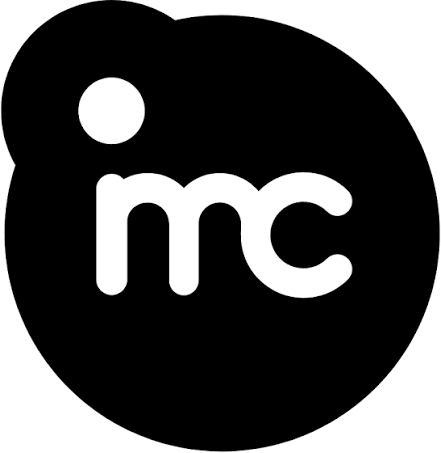
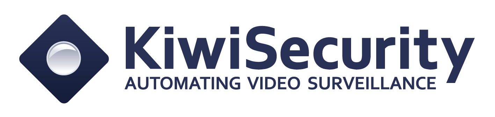
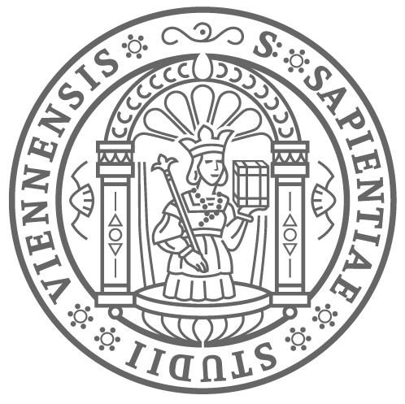
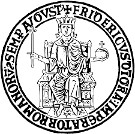

<section>

  
2021&ndash;heute

  

    

    

  

  

    

      <b>Lead AI Scientist</b> (seit 2023) bei <a href="https://piurimaging.com/" target="_blank" rel="noopener">piur imaging GmbH</a> in Wien.
      <ul>
        <li>Aufbau und Leitung eines Teams von drei AI Engineers; Planung und Priorisierung der KI-Roadmap im Einklang mit den Unternehmenszielen</li>
        <li>Modelle in Produktion gebracht für die Segmentierung von Schilddrüse, Venen und Karotisplaque-Volumen (CPV) sowie die Seitenerkennung der Schilddrüse; außerdem Entwicklung einer TI-RADS-Klassifikation</li>
        <li>Sensorloses 3D-Tracking: Schätzung von 3D-Rotationen und -Translationen allein aus transversalen Ultraschallbildern; das aktuelle Modell erreicht einen Fehler von 5&nbsp;% der mittleren Scanlänge über Geräte und Organe hinweg</li>
        <li>3D-Volumetrie der Schilddrüse, bisher nicht verfügbar (klinisch nur 2D-Ultraschall): Segmentierung per Klick in 20&nbsp;s statt 3&nbsp;Minuten manueller Annotation</li>
        <li>Fine-Tuning von Foundation Models (SAM, MedSAM) auf eigenen Ultraschalldaten für Zero-Shot-Segmentierung von Organen, die nicht im Training enthalten waren</li>
        <li>Federated Learning mit NVIDIA FLARE in einem FFG-geförderten Projekt</li>
        <li>Technische KI-Dokumentation für MDR- und FDA-Einreichungen</li>
      </ul>
    

    

      <b>Senior Deep Learning Scientist</b> (2021&ndash;2023) bei piur imaging GmbH.
      <ul>
        <li>Einstieg in ein Unternehmen ohne bisherige KI und Aufbau der KI-Entwicklung von Grund auf</li>
        <li>Entwicklung der ersten produktiven Deep-Learning-Modelle des Unternehmens für 3D-Tracking sowie Schilddrüsen- und Karotissegmentierung</li>
        <li>Aufbau eines DICOM-Client-Server-Systems</li>
        <li>Aufbau des MLOps-Stacks (Airflow, später ClearML) für nachvollziehbare und reproduzierbare Experimente; Festlegung von Datenformaten, Coding-Richtlinien für maschinelles Lernen und CI/CD</li>
        <li>Schneller Weg von der Forschung in die Produktion: Die KI-Software ist ein eigenständiges, testbares Python-Repository, unabhängig von der Produktoberfläche</li>
      </ul>
    

  

  
2024&ndash;2026

  

    

    
<picture><source srcset="/assets/images/imc-logo-dark.png" media="(prefers-color-scheme: dark)"></picture>

  

  

    <b>Lektor</b> (nebenberuflich) an der <a href="https://www.imc.ac.at" target="_blank" rel="noopener">IMC Krems</a>, Österreich.
    <ul>
      <li>Lehrveranstaltung Data Mining</li>
      <li>Lehrveranstaltung &bdquo;Image Processing and Visual Computing in Biology and Medicine&ldquo; im Bachelorstudium Bioinformatik, mit klassischer Bildverarbeitung und Deep Learning</li>
    </ul>
  

  
2018&ndash;2020

  

    

    
<picture><source srcset="/assets/images/anyline-logo-dark.png" media="(prefers-color-scheme: dark)"></picture>

  

  

    

      <b>Senior Computer Vision Engineer</b> (2019&ndash;2020) bei <a href="https://anyline.com/" target="_blank" rel="noopener">Anyline GmbH</a> in Wien.
      <ul>
        <li>Forschung und Entwicklung von On-Device-Deep-Learning-Modellen für Zählerablesung, Kennzeichen- und Ausweiserkennung, ausgeliefert im Anyline Mobile SDK, das alle Anyline-Kunden nutzen</li>
        <li>Miterfinder eines in den USA und Europa erteilten Patents zur Anonymisierung von Text in Trainingsbildern von Ausweisdokumenten (siehe <a href="/de/publications/">Publikationen</a>)</li>
        <li>Projektmanager für zwei Kundenprojekte</li>
      </ul>
    

    

      <b>Computer Vision Engineer</b> (2018&ndash;2019) bei Anyline GmbH.
      <ul>
        <li>Entwicklung von Deep-Learning-Modellen für mobile Geräte zur Dokumentenerkennung auf unterschiedlichen Hintergründen (20&nbsp;% höhere Scan-Genauigkeit und -Geschwindigkeit), zur Schärfeerkennung und zur Klassifizierung von Ausweistypen</li>
        <li>Verbesserung der agilen Prozesse des Mobile-SDK-Teams als Scrum Master</li>
        <li>Einarbeitung neuer Kolleginnen und Kollegen</li>
      </ul>
    

  

  
2016&ndash;2017

  

    

    
<picture><source srcset="/assets/images/kiwi-logo-dark.png" media="(prefers-color-scheme: dark)"></picture>

  

  

    <b>Computer Vision Developer</b> bei <a href="https://www.genetec.com/products/unified-security/omnicast/video-analytics" target="_blank" rel="noopener">KiwiSecurity GmbH (heute die Video-Analytics-Abteilung von Genetec)</a> in Wien.
    <ul>
      <li>Optimierung und Weiterentwicklung von Videoüberwachungsanwendungen</li>
      <li>Neugestaltung der Anwendung Activity Analyzer für GPU-Hardware</li>
      <li>Einführung von Unit-Tests und automatischer Dokumentation für die bestehende Codebasis</li>
      <li>Einarbeitung eines neuen Teammitglieds</li>
    </ul>
  

  
2012&ndash;2016

  

    

    
<picture><source srcset="/assets/images/univie-logo-dark.png" media="(prefers-color-scheme: dark)"></picture>

  

  

    <b>Doktorat in Informatik</b> mit Schwerpunkt Computer Vision an der <a href="https://www.univie.ac.at/" target="_blank" rel="noopener">Universität Wien</a>, Fakultät für Informatik, betreut von <a href="https://www.csc.univie.ac.at/scherzer/" target="_blank" rel="noopener">Univ.-Prof. Dr. Otmar Scherzer</a>, als Mitglied des Computational Science Center (<a href="https://www.csc.univie.ac.at/" target="_blank" rel="noopener">CSC</a>).
    Titel der Dissertation: <a href="https://utheses.univie.ac.at/detail/38425/" target="_blank" rel="noopener">Variational models of visual attention with a special focus on dynamic sequences</a>.
    <ul>
      <li>Entwicklung und Implementierung mathematischer Modelle zur Schätzung der visuellen Aufmerksamkeit in Videos</li>
      <li>Entwicklung eines Bildverarbeitungsalgorithmus zum Dejittering statischer Bilder</li>
      <li>Präsentation der Forschungsergebnisse auf Konferenzen und Veröffentlichungen in internationalen Fachzeitschriften (siehe <a href="/de/publications/">Publikationen</a>)</li>
    </ul>
  

  
2011&ndash;2012

  

    

    
<picture><source srcset="/assets/images/fed2-logo-dark.png" media="(prefers-color-scheme: dark)"></picture>

  

  

    <b>Wissenschaftlicher Mitarbeiter</b> im <a href="http://www.smile.unina.it/index.php/eye-tracker" target="_blank" rel="noopener">SMILE-Projekt</a>, einem Spin-off der Universität Neapel, Italien.
    <ul>
      <li>Entwicklung eines kalibrierungsfreien Eye-Trackers mit Methoden des maschinellen Lernens und der Computer Vision, um den Verlauf von Autismus-Spektrum-Störungen bei Kindern zu beurteilen</li>
      <li>Entwicklung von City &amp; Bus, einer iOS-App für Echtzeitinformationen im öffentlichen Verkehr</li>
      <li>Betreuung von Masterstudierenden</li>
    </ul>
  

  
2008&ndash;2011

  

    

    
<picture><source srcset="/assets/images/fed2-logo-dark.png" media="(prefers-color-scheme: dark)"></picture>

  

  

    <b>Masterstudium Informatik (MSc)</b> an der <a href="http://www.unina.it/en_GB/home" target="_blank" rel="noopener">Universität Neapel Federico II</a>, Italien. Masterarbeit zum Thema &bdquo;Uncalibrated eye-tracking system using Machine Learning for the prediction of the Point of Gaze&ldquo;, hauptsächlich betreut von <a href="https://www.docenti.unina.it/#!/professor/4652414e434553434f495347524f27534752464e4336365432364732373341/riferimenti" target="_blank" rel="noopener">Univ.-Prof. Dr. Francesco Isgr&ograve;</a>. Davor Bachelorstudium Informatik (BSc).
  

  
2007&ndash;2011

  

    

  

  

    <b>Softwareentwickler</b> (Praktikum und freiberufliche Tätigkeit), Italien.
    <ul>
      <li>Entwicklung eines Echtzeit-Webservers zum Streaming von Bild- und Audioinhalten mobiler Geräte für das ICAR-CNR</li>
      <li>Entwicklung von iOS-Apps für Start-ups</li>
    </ul>
  

</section>
<section>
<h2>Kenntnisse</h2>
<ul class="skills">
  <li><b>Deep Learning:</b> PyTorch, torchvision, TensorFlow</li>
  <li><b>Foundation Models:</b> SAM, MedSAM (Fine-Tuning auf Ultraschall, Zero-Shot-Segmentierung)</li>
  <li><b>Computer Vision:</b> OpenCV, scikit-image, Albumentations</li>
  <li><b>Medizinische Bildgebung:</b> Ultraschall (2D/3D), DICOM, MONAI, SimpleITK, pydicom, pynetdicom</li>
  <li><b>Federated Learning:</b> NVIDIA FLARE</li>
  <li><b>Modell-Deployment:</b> ONNX / ONNX Runtime, TensorRT, OpenVINO</li>
  <li><b>MLOps:</b> ClearML, MLflow, DVC, Airflow, TensorBoard</li>
  <li><b>Maschinelles Lernen und Daten:</b> scikit-learn, NumPy, Pandas, Pydantic, Jupyter</li>
  <li><b>KI-gestützte Entwicklung:</b> Claude Code, GitHub Copilot</li>
  <li><b>Programmiersprachen:</b> Python, C++, C</li>
  <li><b>Entwicklungswerkzeuge:</b> Git, Docker, pytest, CMake, Linux, CI/CD</li>
  <li><b>Datenbanken:</b> PostgreSQL, MySQL</li>
  <li><b>Arbeitsweise:</b> Scrum (ehemaliger Scrum Master), Agile, Jira</li>
</ul>
</section>
<section>
<h2>Zertifikate</h2>
<ul class="skills">
  <li><b>Claude Code in Action</b>, Anthropic (2026)</li>
</ul>
</section>
<section>
<h2>Sprachen</h2>

Italienisch (Muttersprache), Englisch (verhandlungssicher), Deutsch (gute Kenntnisse), Rumänisch (Grundkenntnisse).

Ausführlicher Lebenslauf auf Anfrage.

</section>
